# Manuel d’utilisation — Espace formateur FLI

Guide pas à pas pour animer tes missions depuis la plateforme FLI Formation  
(**https://plateforme.fli.fr**).

Les captures ci-dessous utilisent un jeu de démonstration (`ZZTEST…`). Sur ton compte, tu ne vois que **tes** missions et stagiaires.

---

## 1. Se connecter

1. Ouvre **https://plateforme.fli.fr/auth** (ou le lien que Paula t’a envoyé).
2. Utilise la carte **Administration FLI** : ton e-mail formateur + le mot de passe fourni par FLI.
3. Tu arrives sur ton **espace formateur** (tableau de bord).

> La carte « Espace stagiaire » (lien magique) n’est **pas** pour toi — elle sert aux stagiaires uniquement.

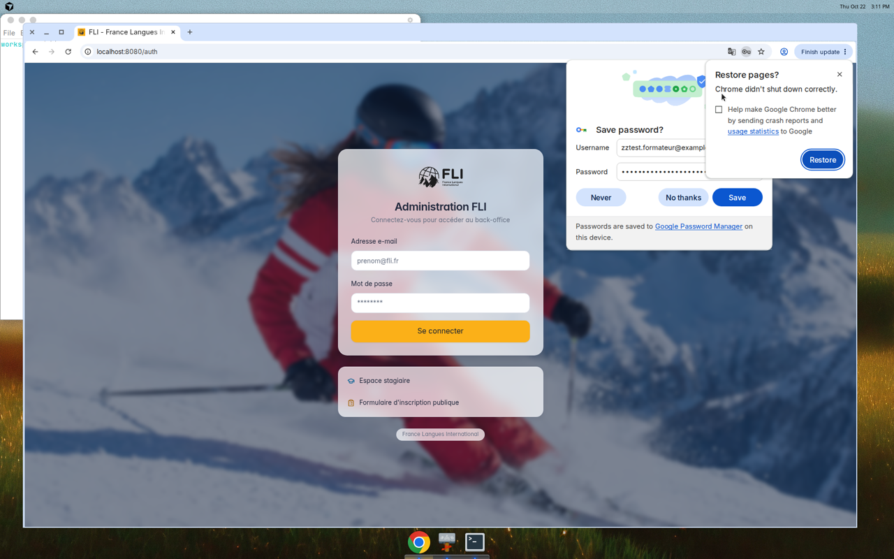

Pour te déconnecter : icône en haut à droite de la barre (à côté de « Espace formateur »).

---

## 2. Le menu

À gauche (ou en bas sur mobile), tu as accès à :

| Rubrique | À quoi ça sert |
|---|---|
| **Tableau de bord** | Vue d’ensemble + rappels « À faire » |
| **Guide FLI** | Qui est FLI, formats de cours, déroulé type |
| **Missions** | Qui / où / quand — fiche détaillée par dossier |
| **Stagiaires** | Contact, attentes, test de placement, niveaux |
| **Bilans** | Formulaires d’entrée et de sortie (CECRL) |
| **Présence** | Émargement numérique + fiche PDF FORMATEUR |
| **Évaluations** | Tests oraux SNMSF (quand tu es examinateur·rice) |
| **Documents** | CV, vigilance, contrats (**lecture seule**) |
| **Paiements** | Rémunérations FLI (**lecture seule**) |
| **Profil** | Identité / fiscal — corrections via **info@fli.fr** |

Tu ne vois jamais les dossiers des autres formateurs. Les montants de formation stagiaire ne s’affichent pas dans cet espace.

---

## 3. Tableau de bord

Point d’entrée après connexion : compteurs (en cours, à venir, stagiaires, évals à saisir), prochaines missions, et une liste **À faire** (bilans, présence, évaluations).

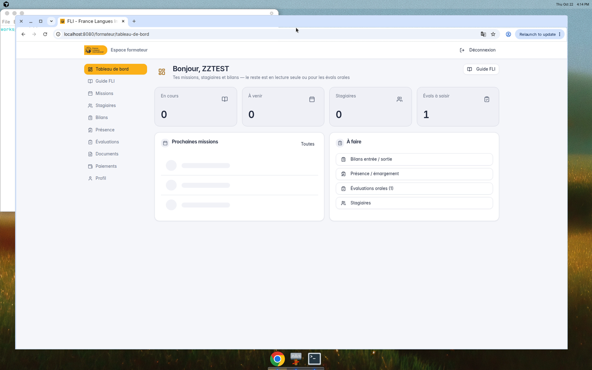

Astuce : clique sur une mission ou une ligne « À faire » pour aller directement à la bonne page.

---

## 4. Guide FLI

Page d’accueil métier : présentation de FLI, formats (présentiel, visio, individuel), et le rôle de chaque rubrique de l’appli. Utile pour une première mission ou un rappel Qualiopi.

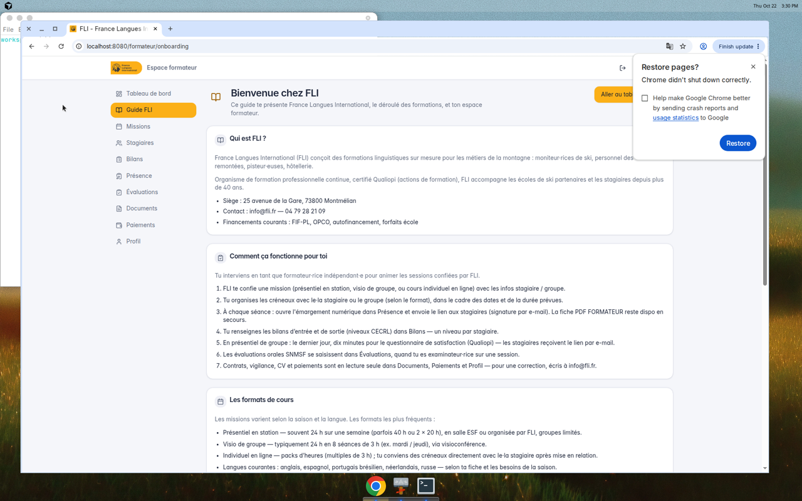

---

## 5. Missions

Liste de tes missions classées **En cours / À venir / Passées**. Chaque carte rappelle langue, dates, horaires, lieu, modalité et statut.

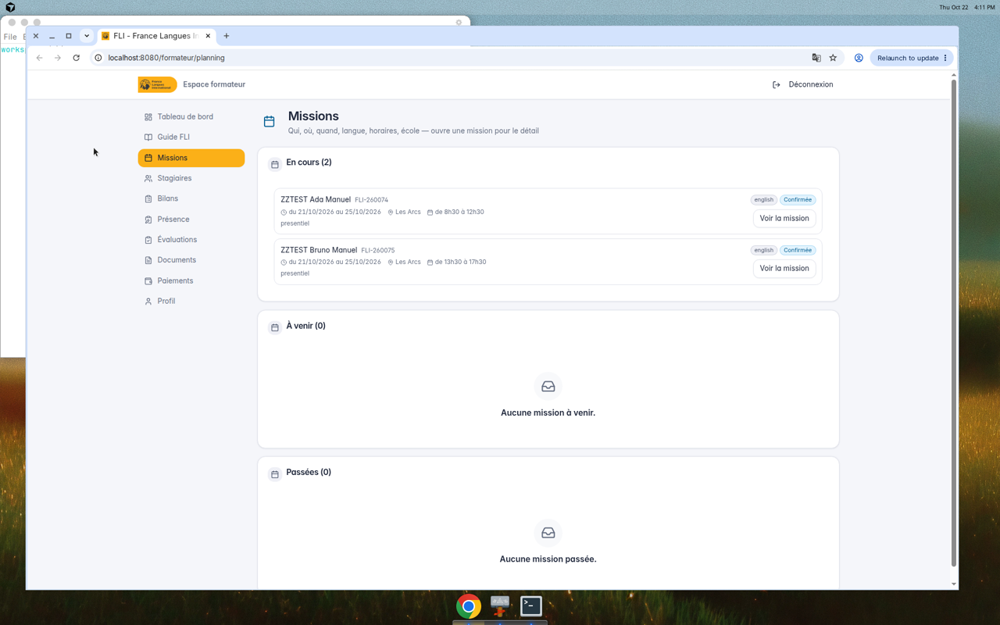

### Fiche mission

Ouvre **Voir la mission** pour le détail :

- dossier (ex. `FLI-260074`), statut, période, horaires, lieu, durée ;
- contact stagiaire (e-mail / téléphone) ;
- raccourcis **Fiche de présence**, **Fiche stagiaire**, formulaires d’**entrée** / **sortie**.

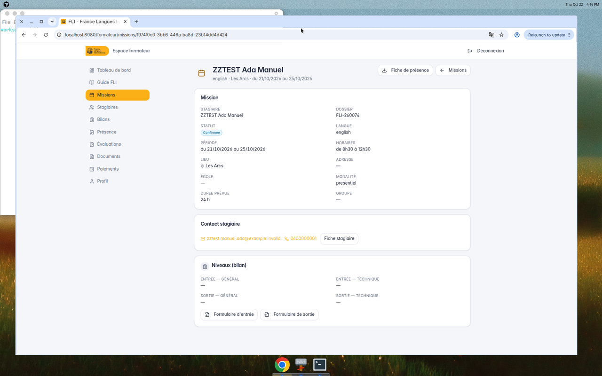

---

## 6. Stagiaires

Liste des stagiaires liés à tes missions, avec un aperçu des niveaux d’entrée / sortie.

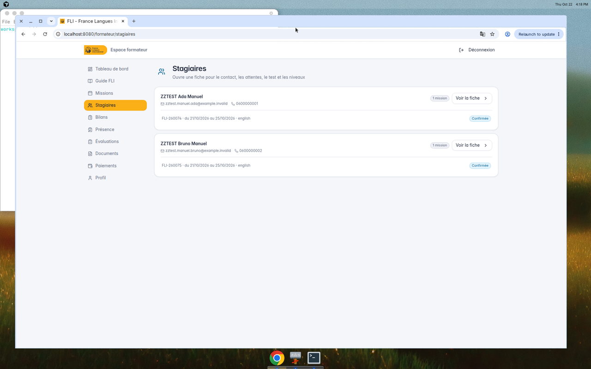

### Fiche stagiaire

Contact, ville / lieu, missions rattachées, **attentes** saisies à l’inscription, résumé du test de placement s’il existe, et niveaux de bilan.

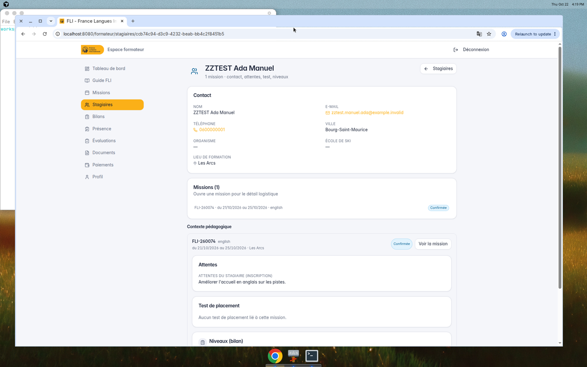

Depuis la fiche tu peux rejoindre la mission ou les formulaires de bilan.

---

## 7. Bilans d’entrée et de sortie

Un niveau d’**entrée** et un niveau de **sortie** par stagiaire (référentiel CECRL). La page affiche l’état (**À faire** / complété) et les boutons **Entrée** / **Sortie**.

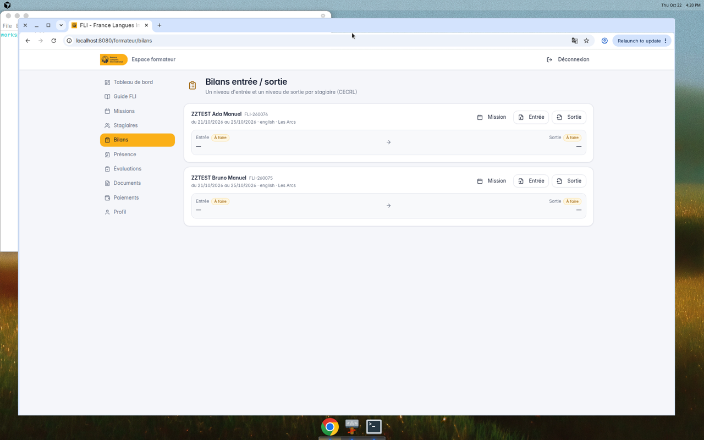

1. Clique sur **Entrée** en début de formation (idéalement dès la première séance).
2. En fin de formation, complète **Sortie** (niveaux + champs demandés selon le format individuel / collectif).
3. Les infos mission (stagiaire, dates, formation) sont préremplies — ne les resaisis pas à la main.

Les bilans alimentent le suivi pédagogique et les documents de fin de formation côté FLI.

---

## 8. Présence (émargement)

Deux outils :

1. **Émargement numérique** — ouvre une séance, envoie le lien aux stagiaires ; ils signent avec l’e-mail d’inscription. Tu marques absences / excuses, puis tu **fermes** la séance.
2. **Fiche de présence PDF FORMATEUR** — secours papier si besoin.

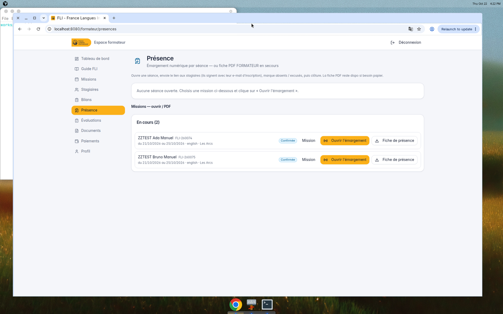

### Déroulé type

1. Sur la mission du jour → **Ouvrir l’émargement**.
2. Partage le lien (e-mail / SMS / affichage en salle).
3. Les stagiaires signent ; tu ajustes les absents.
4. Ferme la séance quand tout le monde a signé (ou que tu as noté les absences).

En présentiel de groupe, les créneaux sont souvent organisés par **demi-journée** (matin / après-midi) ; le vendredi peut être traité en séance d’ensemble selon le planning de la mission. En individuel, tu ouvres une séance pour le créneau convenu.

---

## 9. Évaluations orales (SNMSF)

Réservé aux sessions où tu es **examinateur·rice**. Tu y saisis les notes / phrases, puis tu génères le PDF d’évaluation.

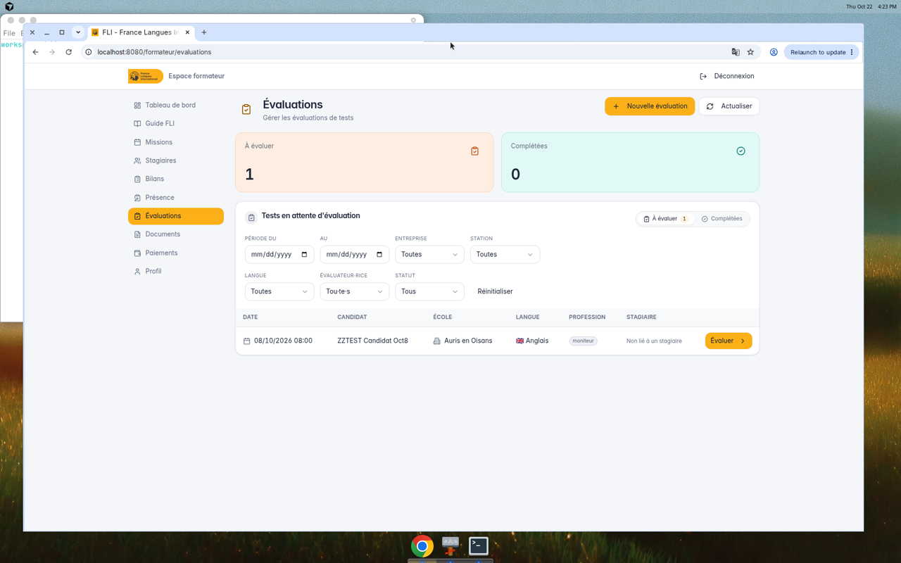

Si aucune session ne t’est attribuée, la page reste vide — c’est normal.

---

## 10. Documents, paiements, profil (lecture seule)

Ces trois rubriques te montrent ce que FLI a en dossier te concernant. Tu ne modifies pas les fichiers ni les montants depuis l’appli.

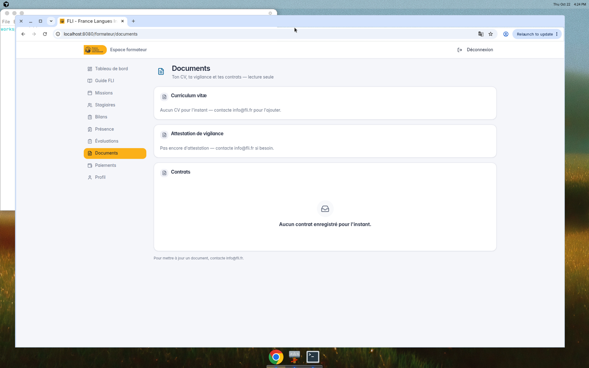

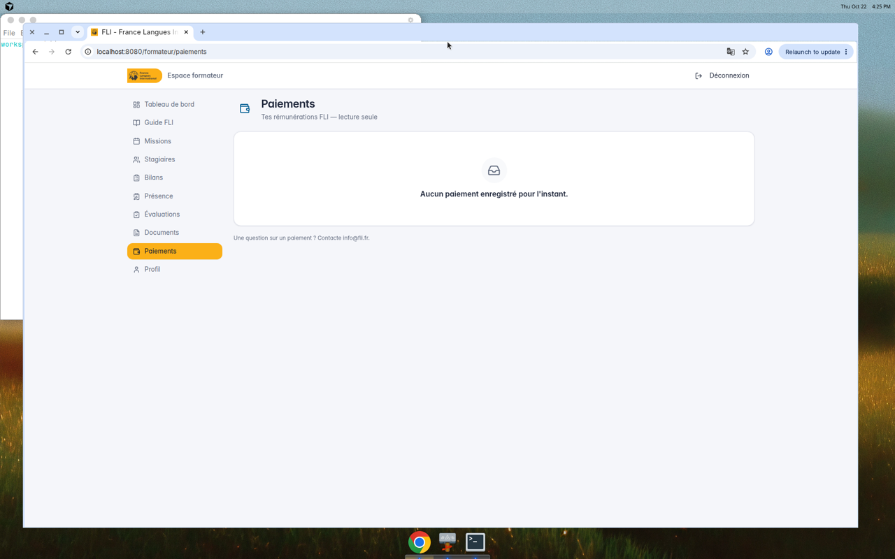

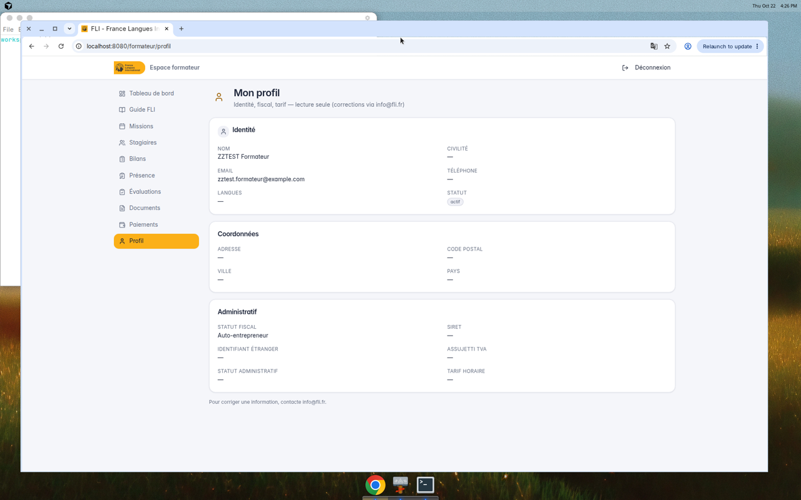

Pour une correction (RIB, adresse, CV, tarif, etc.) : écris à **info@fli.fr**.

---

## 11. Satisfaction stagiaires (Qualiopi)

En fin de formation collective, les stagiaires reçoivent en principe le questionnaire par e-mail. Selon les missions, tu peux aussi disposer d’un bouton d’envoi depuis la fiche mission / stagiaires (envoi ciblé en cas de problème ou de session individuelle).  
Le dernier jour en présentiel de groupe : prévois environ **10 minutes** pour que chacun réponde.

---

## 12. Besoin d’aide ?

- **info@fli.fr** — 04 79 28 21 09  
- Siège : 25 avenue de la Gare, 73800 Montmélian  

Paula et l’équipe FLI restent ton interlocuteur pour les missions, contrats et documents.

---

*Document généré pour l’espace formateur FLI Formation. Captures à jour au 22/10/2026 (Europe/Paris).*
